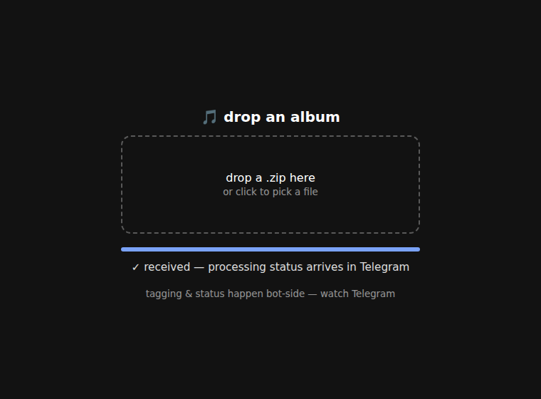

# Music Bot

A Telegram bot for importing music, maintaining tags and managing your [Navidrome](https://www.navidrome.org/) library.

## Setup

1. Save [compose.yaml](compose.yaml) and [.env.example](.env.example) in one directory. Rename
   `.env.example` to `.env`.
2. Follow the [setup guide](docs/setup.md) to fill in credentials, connect your library and prepare
   writable directories. The current stack requires slskd.
3. Run `docker compose up -d`, then send `/start` to your bot.

## Usage

Drop an album ZIP or a folder of tracks into `bot-data/uploads/`. The bot identifies the release,
adds tags and lyrics, files the tracks and asks Navidrome to rescan. Progress arrives in Telegram.
An optional browser upload page feeds the same folder.

- `/retag` previews tag updates across the library; `/retag confirm` applies them.
- `/scan` starts a Navidrome rescan; `/stats` shows library counts and size.
- Inline mode finds library entries, sends the playing track, shares links and shows lyrics.
- Delete an album or track from inline search, with confirmation.

[Usage and inline shortcuts](docs/usage.md) · [Configuration](.env.example) · [Roadmap](ROADMAP.md)

## Development

Python 3.12+, [uv](https://docs.astral.sh/uv/), `uv sync --frozen`, then `uv run pytest`.
Tests use stubbed services and run offline. See [CONTRIBUTING.md](CONTRIBUTING.md).

## License

[MIT](LICENSE)
